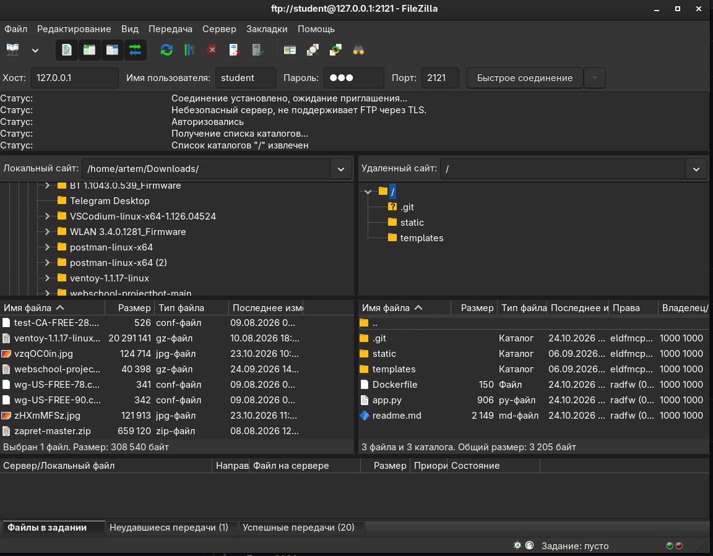
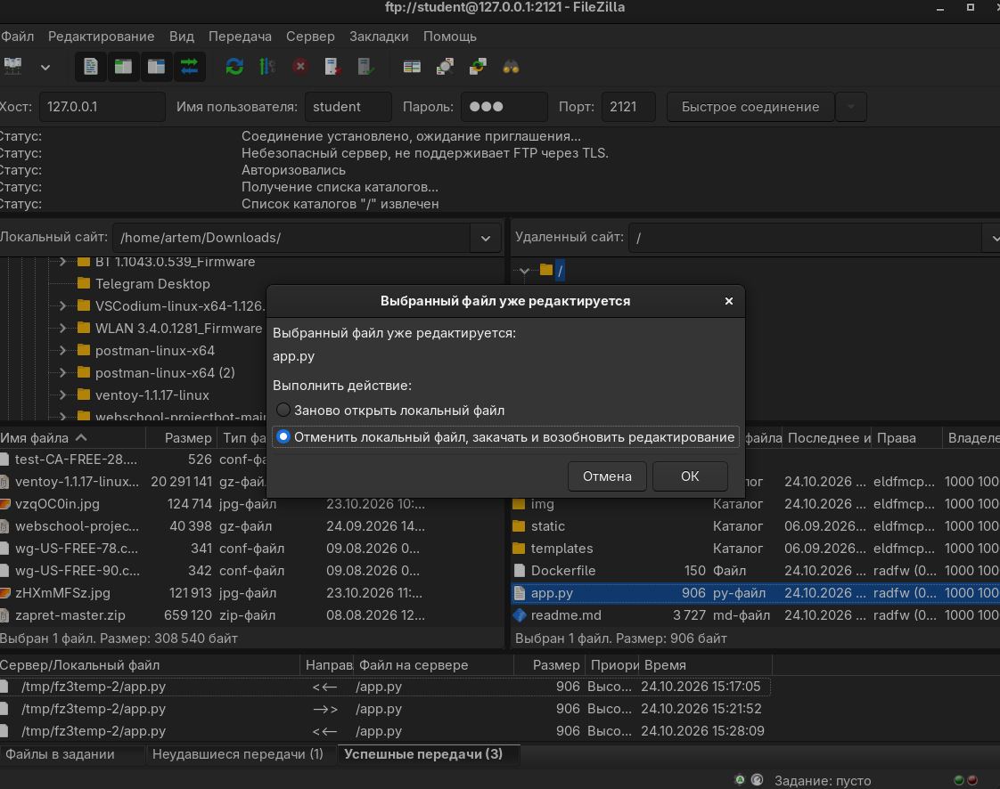
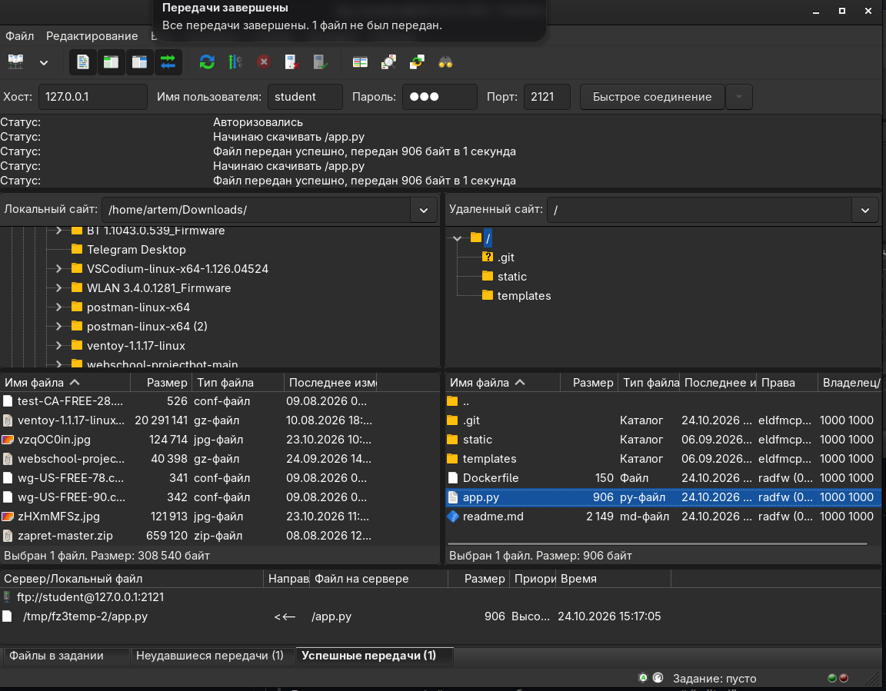
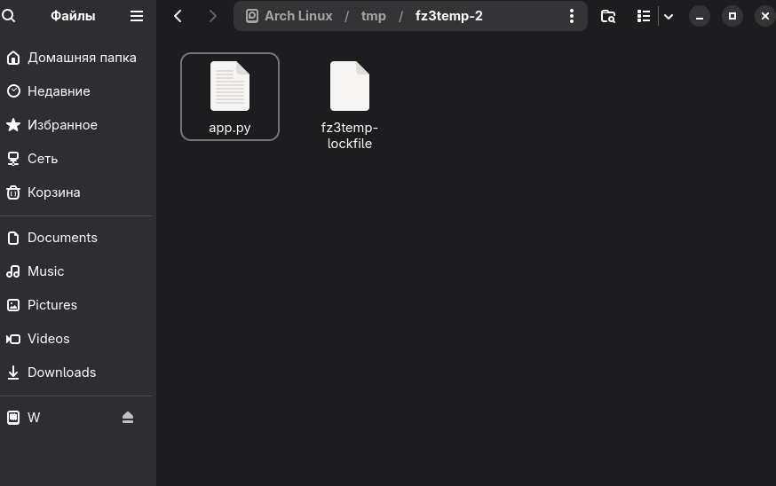
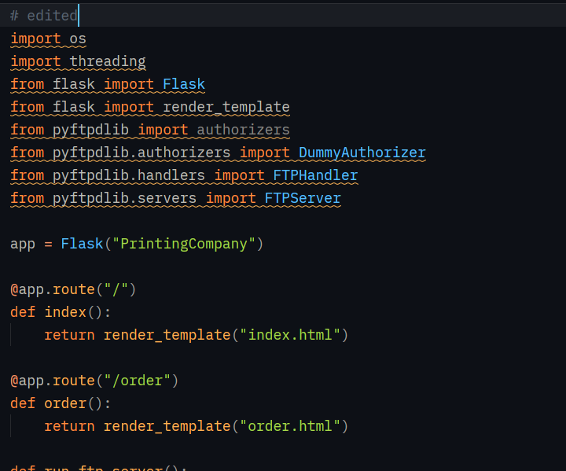
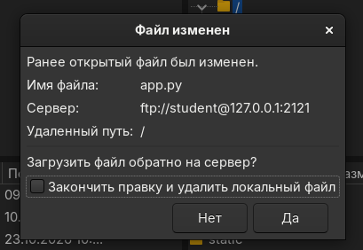
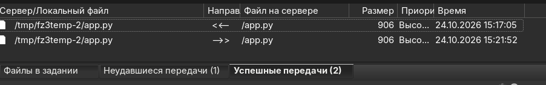

 <h1 align="center">Запуск:</h1>  
 
```
git clone https://github.com/kilanoqqq-q/lab-3-kilanoqqq.git

cd lab-3-kilanoqqq

docker build -t my-app .

docker run --rm -p 5000:5000 -p 2121:2121 -p 30000-30010:30000-30010 my-app
```

<h1 align="center"> Отчёт по лабораторной работе </h1>

**Тема:** настройка FTP-клиента и работа с файлами на сервере

**Цель работы:** настроить FTP-сервер, проверить подключение, освоить скачивание, загрузку и редактирование файлов на сервере.

Используемое ПО:

1. Фреймворк Flask на Python
2. FileZilla
3. Редактор кода Zed

<h1 align="center">Настройка FTP сервера</h1>

Для настройки были импортированы библиотеки и дописан код сайта.

Бибилиотеки, используемые в проекте:

```
import os
import threading
from flask import Flask
from flask import render_template
from pyftpdlib import authorizers
from pyftpdlib.authorizers import DummyAuthorizer
from pyftpdlib.handlers import FTPHandler
from pyftpdlib.servers import FTPServer
```

Функция, для создания и настройки FTP:

```
def run_ftp_server():
    ftp_dir = os.getcwd()

    authorizer = DummyAuthorizer()
    authorizer.add_user('student', '123', ftp_dir, perm='elradfmw') # пользователь "student", пароль "123", полные права доступа

    handler = FTPHandler
    handler.authorizer = authorizer

    server = FTPServer(('0.0.0.0', 2121), handler)
    server.serve_forever()
```

Запуск FTP:

```
if __name__ == "__main__":
    ftp_thread = threading.Thread(target=run_ftp_server, daemon=True)
    ftp_thread.start()

    app.run(debug=True, port=5000, host='0.0.0.0') # запуск самого сайта
```

<h1 align="center">Проверка подключения к FTP серверу</h1>

Проверка проходила в программе FileZilla

Данные для соединения:

- Хост: 127.0.0.1:5000
- Имя пользователя: student
- Пароль: 123
- Порт: 2121



<h1 align="center">Скачивание и загрузка файлов на FTP серверер</h1>

Чтобы скачать файл нужно сделать по нему двойное нажатие. Чтобы загрузить файл на сервер нужно перетащить его мышкой из левого окна в правое.

<h1 align="center">Редактирование текстовый файлов</h1>

Для примера, изменю файл app.py - добавлю в начало комментарий "edited".

Нажимаю правой кнопкой мыши по файлу, выбираю второй вариант и нажимаю "ОК".





Снизу указан путь, куда сохранился файл. Перехожу туда: 



Открываю файл и добавляю строчку:



Сохраняю изменения. Далее в окне FileZilla вижу уведомление:



Ставлю галочку и нажимаю "Да". После этого вижу, что передача на сервер прошла успешно: 


